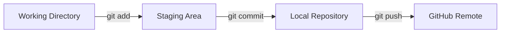
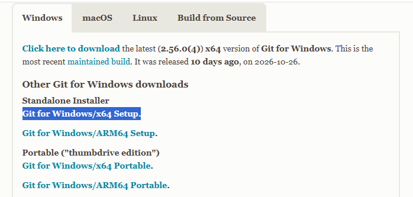

headline, heading
h1 ~ h6
# 제목1
## 제목2
밑줄까지 그어주는 경우가 많아서 큰 제목
### 제목3
#### 제목4
##### 제목5
###### 제목6
그냥 내용

안녕하세요
안녕하세요

안녕하세요 (문단 바뀜)

안녕하세요  
스페이스두개 (줄바꿈)

안녕하세요<br>
태그를 일부 사용가능

<center>가운데정렬</center>

---
___

Markdown Preview Github Styling

**강조** *한개* _아아_ __아아__ ***강조기울임*** ___강조기울임___

**문제가! (있어요)**입니다.
**문제가! (있어요)**
문제가! **(있어요)**
<strong>문제가! (있어요)</strong>입니다.

Git(깃)입니다 **Git(깃)**입니다 <strong>Git(깃)</strong>입니다

#자꾸 붙임
** 반대로 자꾸 땜 **

- 순서없는 말머리
    - 들여쓰기
+ 플러스하셔도 됩니다
    * 곱하기
* ***ㅎㅎ***
** 
1. 
2. 
4. 


4.
6. 
---
1.
1.
1.
1.
---
1.
1.

---

> 인용
> > 인용 내 인용
> > > 인용 내 인용
가능하면 2단계만

<!-- html 주석과 동일 -->
<!-- 감싸고 ctrl + / -->

`물결표 그냥 누른거`
> 모노스페이스로 (가로가 동일한 폰트폭) 표시해줌
hello world
`hello world`
git add *f*
`git add *f*`
- 마크다운 문법을 무시하고 표시 (인라인 코드)

```
print("hello")
print('i dont know')
```

- 컬러셋 또는 파싱
```python
print("hello")
print('i dont know')
```

```java
import java.util.*;

System.out.println("Hello World");
```



- [링크](https://naver.com)


[](https://naver.com)

::형광펜:: <mark>형광펜</mark>

테이블
|제목1|제목2|제목3|
|----|-----|----|
|내용1|내용2|내용3|
|내용1|내용2|내용3|

|1|2|3|
|-|-:|:-:|
|내용1|내용2|내용3|
|내용1|[링크](https://naver.com)|내용3|