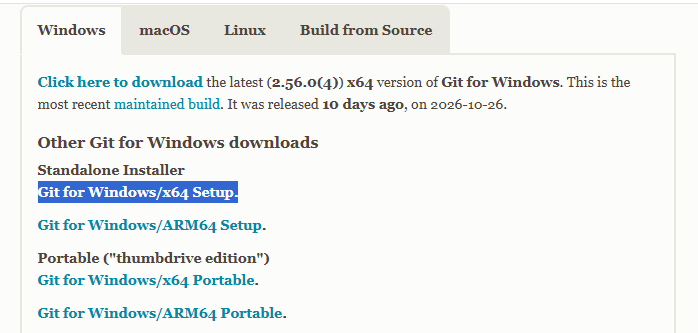
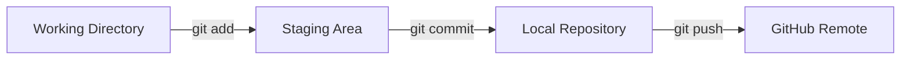
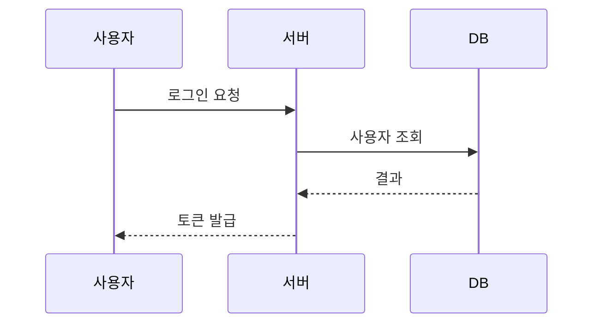
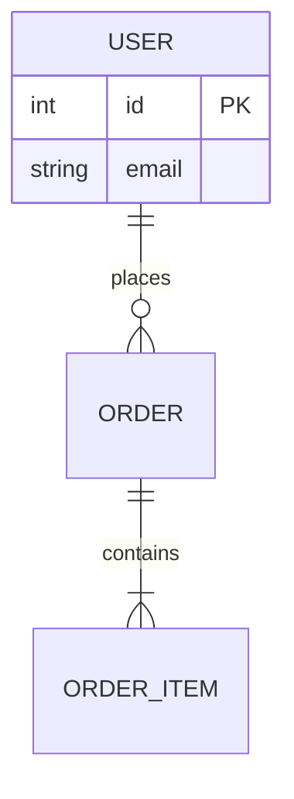
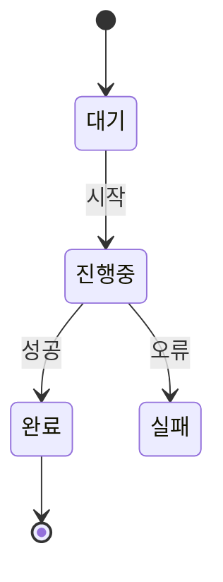
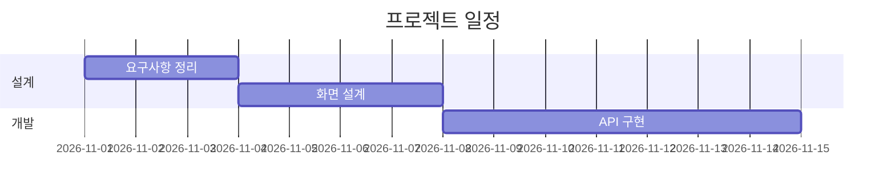

# Markdown 문법 완전 정복

> **교재**: 이 저장소의 `README.md` 실습 노트
>
> **대상**: 마크다운을 처음 쓰는 사람 ~ 문서 담당을 맡게 된 개발자
>
> **목표**: ① 오늘 바로 쓰는 문법 ② 깨졌을 때 스스로 고치는 능력 ③ 면접·운영에서 통하는 문서 감각

---

## 목차

- [0. 이 문서를 읽는 방법](#0-이-문서를-읽는-방법)
- [1. Markdown이 뭐예요?](#1-markdown이-뭐예요)
- [2. 3분 치트시트](#2-3분-치트시트)
- [3. 기본 문법](#3-기본-문법)
- [4. GitHub에서만 되는 문법](#4-github에서만-되는-문법)
- [5. 트러블슈팅](#5-트러블슈팅)
- [6. 응용 케이스](#6-응용-케이스)
- [7. 실무 운영 팁](#7-실무-운영-팁)
- [8. 면접 대비 Q&A](#8-면접-대비-qa)
- [9. 연습 문제](#9-연습-문제)
- [10. 참고 자료](#10-참고-자료)

---

## 0. 이 문서를 읽는 방법

### 0.1 누구를 위한 문서인가요?

마크다운은 **"메모장에 쓰는 약속된 기호"** 입니다. 프로그래밍 언어처럼 어렵지 않아요. 다만 다음과 같은 순간에 사람들이 자주 막힙니다.

- `**굵게**`라고 썼는데 별표가 그대로 보인다.
- 줄을 바꿨는데 화면에서는 한 줄로 붙어 있다.
- 표를 만들었는데 표가 아니라 글자로 보인다.
- 내 미리보기에서는 예쁜데 GitHub에서는 다르게 보인다.

이 문서는 그런 **"왜 안 되지?"** 를 하나씩 해결합니다. 동시에, 나중에 기술 면접이나 프로젝트 운영에서 "문서를 어떻게 관리하시나요?"라고 물었을 때 답할 수 있는 수준까지 다룹니다.

### 0.2 표기 규칙

문서 전체에서 다음 표기를 사용합니다.

| 표기 | 의미 |
|---|---|
| ✅ | 이렇게 쓰면 좋아요 |
| ❌ | 이렇게 쓰면 깨져요 |
| 💡 | 실무 팁 |
| ⚠️ | 주의할 점 |
| 🎯 | 면접 포인트 |
| 🔧 | 트러블슈팅 |

그리고 **"입력"** 에는 실제로 타이핑하는 내용을, **"결과"** 에는 화면에 보이는 모습을 적습니다. 이 문서 자체가 마크다운이므로, 미리보기로 열면 결과를 직접 확인할 수 있습니다.

### 0.3 README.md와 이 문서의 관계

`README.md`는 직접 명령을 쳐 보며 남긴 **날것의 실습 메모**입니다. 이 문서(`syntax.md`)는 그 메모를 다음 순서로 다시 정리한 **교과서**입니다.

1. README에 나온 문법을 빠짐없이 설명한다.
2. 왜 그렇게 동작하는지 원리를 덧붙인다.
3. README에서 실제로 깨진 부분을 복기한다.
4. 실무에서 쓰는 템플릿과 운영 방법으로 확장한다.

> 💡 **가장 좋은 공부법**: 이 문서를 읽기만 하지 말고, 빈 `.md` 파일을 하나 만들어 옆에 두고 **직접 타이핑**하세요. 손으로 쳐야 기호 위치가 익숙해집니다.

### 0.4 목적별 추천 읽기 순서

| 목적 | 읽을 장 |
|---|---|
| 오늘 당장 문서를 써야 한다 | 2장(치트시트) → 3장(기본 문법) |
| 프로젝트 README를 만들고 싶다 | 2장 → 3장 → 6.1 |
| 깨진 문서를 고쳐야 한다 | 5장(트러블슈팅) |
| 문서 운영을 맡았다 | 7장(실무 운영 팁) |
| 기술 면접을 준비한다 | 1장 → 7장 → 8장(Q&A) |

---

## 1. Markdown이 뭐예요?

### 1.1 한 문장으로

> **Markdown(마크다운)** 은 `#`, `*`, `-`, `|` 같은 **간단한 기호로 문서의 구조를 표현하는 경량 마크업 언어**입니다.

"마크업(markup)"은 문서에 "이건 제목, 이건 강조, 이건 목록"이라고 **표시(mark)** 를 하는 일입니다. HTML도 마크업 언어인데, HTML은 `<h1>제목</h1>`처럼 태그를 전부 써야 해서 손이 많이 갑니다. 마크다운은 `# 제목` 한 글자면 끝입니다.

### 1.2 왜 개발자들이 쓰나요?

| 이유 | 설명 |
|---|---|
| **글자 그대로 저장된다** | `.md` 파일은 그냥 텍스트입니다. 메모장, VS Code, GitHub 어디서든 열립니다. |
| **Git과 잘 맞는다** | 텍스트라서 변경 내용을 줄 단위로 비교(`diff`)할 수 있습니다. "누가 언제 어떤 문장을 고쳤는지" 추적됩니다. |
| **구조가 남는다** | 제목·목록·표로 구조를 표현하므로 목차, 검색, 변환이 쉽습니다. |
| **어디서나 변환된다** | HTML, PDF, PPT, 웹사이트, 위키로 변환할 수 있습니다. |
| **집중하기 좋다** | 디자인보다 **내용**에 집중하게 됩니다. |

> 🎯 **면접 포인트**: "왜 문서를 Word가 아니라 Markdown으로 관리하나요?"라는 질문에는 **"텍스트 기반이라 Git으로 버전 관리·코드 리뷰·CI 자동화가 가능하고, 코드와 같은 저장소에서 함께 관리할 수 있기 때문"** 이라고 답하면 좋습니다.

### 1.3 HTML과의 관계

마크다운은 HTML을 **완전히 대체하는 언어가 아닙니다.** 다음과 같은 관계입니다.

- 마크다운은 **작성용 언어**이고, 최종적으로 화면에 보이는 것은 보통 **HTML**입니다.
- 마크다운 안에 HTML을 **섞어 쓸 수 있습니다.** (예: `<br>`, `<mark>`, `<details>`)
- 그래서 "마크다운 = HTML의 간편한 문법"이라고 이해하면 쉽습니다.

```
마크다운 원본  →  (변환)  →  HTML  →  브라우저 화면
# 안녕           <h1>안녕</h1>        큰 제목으로 표시
```

### 1.4 화면에 보이기까지 (렌더링 파이프라인)

이 과정을 알면 "미리보기와 GitHub이 왜 다르지?"라는 의문이 풀립니다.

```
1. 원본 텍스트(.md)
        ↓
2. 파서(Parser)      : 기호를 해석해서 문서 구조(AST)로 만든다
        ↓
3. 렌더러(Renderer)  : 구조를 HTML로 바꾼다
        ↓
4. 살균(Sanitizer)   : 위험한 HTML/스크립트를 제거한다
        ↓
5. CSS               : 글꼴·여백·색을 입힌다
```

- **파서**는 "번역기"입니다. `# 제목`을 "1단계 제목"이라는 구조로 번역합니다.
- **AST**는 "문서의 설계도"입니다. 제목 안에 강조가 들어 있고, 목록 안에 항목이 몇 개 있는지 같은 정보가 담깁니다.
- **살균**은 보안 담당입니다. `<script>alert(1)</script>` 같은 위험한 코드를 지웁니다.
- **CSS**는 옷입니다. 같은 HTML이라도 옷을 어떻게 입히느냐에 따라 전혀 다르게 보입니다.

> 💡 **중요**: VS Code 확장 "Markdown Preview Github Styling"은 **CSS만 GitHub처럼** 바꿉니다. 파서는 VS Code 것이므로, **문법 해석 결과가 GitHub과 다를 수 있습니다.** "미리보기가 예쁘니까 GitHub에서도 똑같겠지"는 착각입니다.

### 1.5 방언(Dialect): CommonMark와 GFM

마크다운은 원래 표준이 느슨했습니다. 그래서 구현체마다 조금씩 다르게 동작했고, 이를 정리한 표준이 **CommonMark**입니다.

| 이름 | 정체 | 특징 |
|---|---|---|
| **Markdown** | 2004년 John Gruber가 만든 원형 | 문서화가 느슨함 |
| **CommonMark** | 커뮤니티가 만든 엄격한 표준 명세 | 파서마다 결과가 거의 같아짐 |
| **GFM** | GitHub Flavored Markdown | CommonMark + 표, 취소선, 체크박스, 자동 링크, 각주, 알림 |
| **플랫폼 방언** | GitLab, Obsidian, Notion, 티스토리 등 | 각자 확장 문법이 있음 |

> ⚠️ **핵심**: `==형광펜==`, `::형광펜::`, `[[위키링크]]` 같은 문법은 **표준이 아닙니다.** 특정 앱에서만 동작합니다. GitHub에서는 그냥 글자로 보입니다.

### 1.6 파일과 인코딩

- 확장자는 `.md`를 가장 많이 씁니다. `.markdown`도 동작합니다.
- 인코딩은 **UTF-8**을 권장합니다. 한글이 깨지는 대부분의 문제는 인코딩 차이입니다.
- 파일명은 보통 **소문자 + 하이픈**을 씁니다. 예: `getting-started.md`, `api-reference.md`
  - 이유: 서버(특히 Linux/GitHub)는 **대소문자를 구분**합니다. `Image.png`와 `image.png`는 다른 파일입니다.

---

## 2. 3분 치트시트

바쁠 때 이 표만 봐도 대부분 해결됩니다.

| 기능 | 문법 | 메모 |
|---|---|---|
| 제목 1~6 | `# 제목` ~ `###### 제목` | `#` 뒤에 **공백 필수** |
| 문단 | 빈 줄 | 한 줄 띄우면 새 문단 |
| 줄바꿈 | 줄 끝에 스페이스 2개 또는 `<br>` | 눈에 안 보여서 실수 많음 |
| 굵게 | `**텍스트**` | 기호 안쪽 공백 금지 |
| 기울임 | `*텍스트*` | `_텍스트_`도 가능 |
| 취소선 | `~~텍스트~~` | GFM |
| 목록 | `- 항목` | `+`, `*`도 가능 |
| 번호 목록 | `1. 항목` | 숫자는 자동 정렬됨 |
| 인용 | `> 인용` | 중첩은 `> >` |
| 인라인 코드 | `` `코드` `` | 문법 무시하고 그대로 표시 |
| 코드 블록 | 백틱 3개 + 언어 | 색상 강조 |
| 링크 | `[텍스트](URL)` | |
| 이미지 | `` | 대체텍스트는 접근성 |
| 표 | `\| A \| B \|` + 구분선 | 위에 빈 줄 필요 |
| 체크박스 | `- [ ]` / `- [x]` | GFM |
| 수평선 | `---` | 위에 빈 줄 필요 |
| 주석 | `<!-- 내용 -->` | 화면에 안 보임 |
| 형광펜 | `<mark>텍스트</mark>` | HTML |
| 접기 | `<details><summary>` | GitHub 지원 |
| 다이어그램 | 백틱 3개 + `mermaid` | GitHub 지원 |
| 각주 | `[^1]` + `[^1]: 설명` | GFM |

---

## 3. 기본 문법

README에 나온 순서대로, 실제로 손에 익히는 순서로 설명합니다.

### 3.1 제목 (Heading)

제목은 문서의 **목차이자 뼈대**입니다. 책의 장·절처럼 단계를 나눕니다.

| 단계 | 문법 | 보통 쓰임 |
|---|---|---|
| H1 | `# 제목1` | 문서 전체 제목 (보통 1개) |
| H2 | `## 제목2` | 큰 장 |
| H3 | `### 제목3` | 장 안의 절 |
| H4 | `#### 제목4` | 더 작은 항목 |
| H5 | `##### 제목5` | 거의 안 씀 |
| H6 | `###### 제목6` | 거의 안 씀 |

**입력**

```markdown
# 제목1
## 제목2
### 제목3
#### 제목4
##### 제목5
###### 제목6
```

**결과**: 1단계부터 6단계까지 크기가 다른 제목으로 표시됩니다.

**절대 잊지 말 것**

```markdown
#자꾸 붙임        ❌ 제목이 아니라 그냥 글자
# 자꾸 띄움        ✅ 제목
```

| 규칙 | 설명 |
|---|---|
| `#` 뒤에 **공백** | `#제목`은 제목이 아닙니다. |
| `#`은 **줄 맨 앞** | 문장 중간의 `#`은 글자입니다. |
| H1은 문서당 1개 | 여러 개면 목차가 혼란스러워집니다. |
| 단계를 건너뛰지 않기 | H2 다음에 바로 H4를 쓰면 접근성·SEO·목차가 깨집니다. |
| 제목 위아래 빈 줄 | 렌더러 호환성이 좋아집니다. |

**제목을 닫는 문법도 있습니다** (잘 안 씀)

```markdown
## 제목 ##
```

끝의 `##`은 장식일 뿐, 결과는 같습니다. 다만 `#` 앞에 공백이 있어야 합니다.

#### 밑줄형 제목 (Setext Heading)

README에 "밑줄까지 그어주는 경우가 많아서 큰 제목"이라고 적힌 부분입니다. `#` 없이 **글자 아래에 `=` 또는 `-`를 긋는** 방식입니다.

```markdown
큰 제목
=======

중간 제목
---------
```

- `=`는 H1, `-`는 H2가 됩니다.
- **초보자가 가장 많이 당하는 함정**: 글 바로 아래에 `---`를 쓰면 수평선이 아니라 **H2 제목**이 됩니다.

```markdown
설명 문장입니다.
---                ❌ 수평선이 아니라 위 문장을 H2로 만듦
```

```markdown
설명 문장입니다.

---                ✅ 빈 줄을 넣어야 수평선
```

> 💡 **실무 팁**: Setext 방식은 요즘 거의 쓰지 않습니다. `#`/`##`를 쓰세요. 다만 **기존 문서를 읽을 때** 알아볼 수 있어야 하고, `---` 버그를 피하려면 꼭 기억해야 합니다.

### 3.2 문단과 줄바꿈

마크다운에서 **줄바꿈은 생각보다 까다롭습니다.** "엔터를 쳤는데 왜 안 바뀌지?"의 대부분이 여기서 나옵니다.

```markdown
안녕하세요
안녕하세요
```

위처럼 **한 번만** 엔터를 치면, 대부분의 렌더러는 **같은 문단으로 보고 공백 한 칸처럼** 붙여 버립니다. 결과는 "안녕하세요 안녕하세요"입니다.

**문단을 바꾸려면 빈 줄**

```markdown
안녕하세요 (첫 번째 문단)

안녕하세요 (두 번째 문단)
```

**줄만 바꾸려면 다음 4가지 중 하나**

| 방법 | 문법 | 특징 |
|---|---|---|
| 후행 공백 2개 | `안녕하세요··` (줄 끝 스페이스 2개) | 보이지 않아 실수 많음 |
| 역슬래시 | `안녕하세요\` | CommonMark에서 동작 |
| HTML 태그 | `안녕하세요<br>` | 가장 명확, 추천 |
| 빈 줄 | 문단 자체를 분리 | 문단 간격이 생김 |

README의 예시:

```markdown
안녕하세요  
스페이스두개 (줄바꿈)

안녕하세요<br>
태그를 일부 사용가능
```

> ⚠️ **함정**: VS Code의 `Trim Trailing Whitespace`(저장 시 trailing space 제거)나 Prettier가 켜져 있으면 **스페이스 2개가 자동 삭제**되어 줄바꿈이 사라집니다. 이럴 땐 `<br>`을 쓰는 게 안전합니다.

> 💡 **실무 기준**: 문단 구분은 **빈 줄**, 강제 줄바꿈은 **`<br>`**. 이 두 가지로 통일하면 거의 문제가 없습니다.

### 3.3 수평선 (Thematic Break)

문서의 구역을 시각적으로 나눌 때 씁니다.

```markdown
---
```

또는

```markdown
___
```

또는

```markdown
***
```

| 규칙 | 설명 |
|---|---|
| 기호 **3개 이상** | `--`는 수평선이 아님 |
| 기호만 있는 줄 | 다른 글자와 섞으면 안 됨 |
| 위에 **빈 줄** | 글 바로 아래 `---`는 Setext H2가 됨 |
| `- - -`처럼 띄어도 됨 | 그래도 수평선 |

> ⚠️ `***`는 강조 기호와 헷갈릴 수 있습니다. **수평선은 `---`로 통일**하는 것을 권장합니다.

### 3.4 강조 (굵게 / 기울임 / 취소선)

| 모양 | 문법 | 결과 |
|---|---|---|
| 굵게 | `**텍스트**` 또는 `__텍스트__` | **텍스트** |
| 기울임 | `*텍스트*` 또는 `_텍스트_` | *텍스트* |
| 굵게 + 기울임 | `***텍스트***` | ***텍스트*** |
| 취소선 | `~~텍스트~~` | ~~텍스트~~ |

#### 강조가 안 되는 3대 원인

**① 기호 안쪽에 공백을 넣었다**

```markdown
** 반대로 자꾸 땜 **     ❌ 별표가 그대로 보임
**반대로 자꾸 땜**       ✅ 굵게
```

여는 기호 바로 뒤, 닫는 기호 바로 앞에 **공백이 있으면 강조로 인식되지 않습니다.**

**② 닫는 기호 뒤에 글자가 바로 붙었다 (문장부호 경계 문제)**

README의 실제 사례입니다.

```markdown
**문제가! (있어요)**입니다.     ❌ 일부 렌더러에서 별표가 그대로 보임
```

닫는 `**`의 **앞 글자가 `)`라는 문장부호**이고 **뒤 글자가 한글**이면, CommonMark 규칙상 "닫는 기호"로 인정되지 않는 경우가 있습니다. 이때는 다음처럼 씁니다.

```markdown
**문제가! (있어요)** 입니다.    ✅ 공백을 넣음 (공백도 출력됨)
<strong>문제가! (있어요)</strong>입니다.   ✅ 가장 안전
```

README에 `<strong>` 예시가 함께 있는 이유가 바로 이것입니다.

**③ `_`를 단어 중간에 썼다**

```markdown
snake_case_name       ✅ 그대로 표시 (단어 중간 _는 강조 안 됨)
_기울임_              ✅ 기울임
```

코드나 파일명에 `_`가 많다면 `*` 대신 `_`를 쓰거나, 아예 인라인 코드로 감싸세요.

> 💡 **실무 팁**: 한글 문서에서는 `**`가 문장부호와 만나 자주 깨집니다. 중요한 강조는 **`<strong>`** 을 쓰거나, 닫는 기호 뒤에 **공백**을 두는 습관이 안전합니다.

> 🎯 **면접 포인트**: "마크다운 강조가 왜 안 먹을 수 있나요?" → **"여는/닫는 구분자(delimiter run)의 좌우 문맥 규칙 때문입니다. 공백·문장부호 위치에 따라 강조로 인정되지 않을 수 있습니다."** 라고 설명하면 원리를 이해하고 있다는 인상을 줍니다.

### 3.5 목록 (List)

#### 순서 없는 목록

```markdown
- 사과
- 바나나
- 포도
```

`-`, `+`, `*` 모두 됩니다. README처럼 섞어도 되지만, **한 문서에서는 하나로 통일**하는 게 좋습니다.

```markdown
- 순서없는 말머리
    - 들여쓰기
+ 플러스하셔도 됩니다
    * 곱하기
* ***ㅎㅎ***
```

#### 순서 있는 목록

```markdown
1. 첫 번째
2. 두 번째
3. 세 번째
```

**충격적인 규칙**: 마크다운은 **숫자를 세지 않습니다.** 첫 숫자만 의미가 있고, 나머지는 자동으로 이어집니다.

```markdown
4. 넷
6. 여섯
```

결과는 `4.` `5.`로 표시됩니다. (6은 무시됨)

```markdown
1. 하나
1. 하나
1. 하나
```

결과는 `1.` `2.` `3.`입니다. **일일이 번호를 고칠 필요가 없습니다.**

README의 `4.` `6.` 실험이 바로 이 규칙을 확인한 것입니다.

> ⚠️ 빈 항목(`1. `, `** `)은 렌더러에 따라 목록으로 인식되지 않거나 사라집니다. 내용을 꼭 넣으세요.

#### 들여쓰기(중첩)

```markdown
- 상위
  - 하위
    - 더 하위
```

| 규칙 | 설명 |
|---|---|
| **2~4칸** | 렌더러마다 조금씩 다르지만 2칸 또는 4칸이 무난 |
| **일관성** | 어떤 곳은 2칸, 어떤 곳은 3칸 → 깨지기 쉬움 |
| **탭보다 스페이스** | 탭은 환경마다 폭이 달라 깨질 수 있음 |
| 부모 내용 시작 위치 | `- `는 2칸, `1. `는 3칸이 기준 |

> 💡 **실무 팁**: 중첩 목록은 **2칸**으로 통일하고, 3단계까지만 쓰세요. 4단계부터는 읽기 어렵고 모바일에서 깨집니다.

#### 목록 안에 문단·코드 넣기

````markdown
- 항목 설명

  이어지는 문단입니다. (앞에 2칸 이상)

  ```python
  print("코드도 가능")
  ```
````

목록 안의 코드 블록은 **목록 내용의 들여쓰기만큼** 띄워야 합니다. 어렵다면 목록을 끝내고 코드를 밖에 두는 게 낫습니다.

#### 체크박스 (GFM)

```markdown
- [ ] 아직 안 한 일
- [x] 끝난 일
```

GitHub 이슈/PR에서 자주 씁니다. 자세한 내용은 [4장](#4-github에서만-되는-문법)에서 다룹니다.

### 3.6 인용 (Blockquote)

```markdown
> 인용문입니다.
> 두 번째 줄입니다.
```

**중첩 인용**

```markdown
> 1단계
> > 2단계
> > > 3단계
```

README에 "가능하면 2단계만"이라고 적힌 이유:

- 3단계부터는 들여쓰기가 과해져 **모바일에서 읽기 어렵습니다.**
- 색 대비가 낮아 접근성이 떨어집니다.
- 대부분의 문서는 2단계면 충분합니다.

**인용 안에서 다른 문법 사용**

```markdown
> **중요**: 인용 안에서도 강조, 목록, 코드가 됩니다.
>
> - 목록도 가능
> - 이렇게
```

> 💡 **실무 팁**: 인용은 "남의 말", "경고", "참고"에 씁니다. GitHub에서는 `> [!NOTE]` 형태의 **알림(Admonition)** 을 더 많이 씁니다.

### 3.7 주석 (Comment)

화면에는 보이지 않지만, 소스를 열면 남아 있는 메모입니다.

```markdown
<!-- html 주석과 동일 -->
<!-- 감싸고 ctrl + / -->
```

| 특징 | 설명 |
|---|---|
| 화면에 안 보임 | 미리보기·GitHub 렌더링에서 사라짐 |
| 소스에는 남음 | 협업자에게 메모를 남길 수 있음 |
| HTML 주석과 동일 | `<!-- -->` |
| VS Code 단축키 | 블록 선택 후 `Ctrl` + `/` |

**어디에 쓸까?**

- "이 문단은 나중에 고칠 것"
- "이 이미지는 임시 파일"
- "TODO: 스크린샷 교체"
- 초안 작성 시 메모

> ⚠️ 주석에 **비밀번호·토큰·개인정보**를 쓰면 안 됩니다. 소스는 그대로 공개됩니다.

### 3.8 인라인 코드

문장 중간에 **코드, 명령어, 파일명**을 표시할 때 씁니다. 백틱(`` ` ``)으로 감쌉니다.

```markdown
`물결표 그냥 누른거`
```

결과: `물결표 그냥 누른거`

백틱 안에서는 **마크다운 문법이 무시**됩니다. 이게 핵심입니다.

```markdown
git add *f*        → *f*가 기울임으로 해석될 수 있음
`git add *f*`      → 별표까지 그대로 표시
```

| 용도 | 예 |
|---|---|
| 명령어 | `git status` |
| 파일명 | `README.md` |
| 함수명 | `println()` |
| 변수명 | `userName` |
| 키보드 키 | `Ctrl` + `C` |
| 짧은 코드 | `if (x > 0)` |

**백틱 자체를 표시하고 싶다면** 백틱을 두 개로 감쌉니다.

```markdown
`` `백틱` ``     →  `백틱`
```

> 💡 **실무 팁**: 코드와 설명을 구분하는 가장 쉬운 방법이 인라인 코드입니다. "`main` 브랜치에 `push`하세요"처럼 쓰면 읽는 사람이 즉시 구분합니다.

### 3.9 코드 블록

여러 줄 코드는 백틱 3개로 감쌉니다.

**언어 없이**

````markdown
```
print("hello")
print('i dont know')
```
````

**결과**: 회색 박스 안에 코드가 그대로 표시됩니다. 문법 강조(색)는 없습니다.

**언어 지정 (추천)**

````markdown
```python
print("hello")
print('i dont know')
```
````

**결과**: Python 문법에 맞게 색이 입혀집니다. 이걸 **신택스 하이라이팅(syntax highlighting)** 이라고 합니다.

```java
import java.util.*;

System.out.println("Hello World");
```

**언어를 꼭 써야 하나요?**

| 관점 | 설명 |
|---|---|
| 가독성 | 색이 있어 읽기 쉽습니다. |
| 검색/도구 | 언어 정보를 활용해 문서를 분석할 수 있습니다. |
| 복사 | 언어가 표시되면 복사할 때 편합니다. |
| 없어도 동작 | 색만 없을 뿐, 코드 블록은 정상입니다. |

**자주 쓰는 언어 태그**: `bash`, `sh`, `python`, `java`, `javascript`, `js`, `ts`, `json`, `yaml`, `html`, `css`, `sql`, `diff`, `text`, `mermaid`

**코드 블록 안에 백틱 3개를 넣고 싶다면**

바깥을 **백틱 4개**로 감쌉니다.

`````markdown
````markdown
```python
print("hello")
```
````
`````

> ⚠️ 코드 블록을 닫지 않으면 **문서 끝까지 전부 코드로 변합니다.** "갑자기 아래 내용이 회색이 됐다"면 닫는 백틱을 확인하세요.

**들여쓰기 코드 블록 (4칸)**

```markdown
    print("hello")
```

스페이스 4칸으로도 코드 블록이 됩니다. 다만 언어 강조가 안 되고, 목록과 섞이면 헷갈리므로 **백틱을 권장**합니다.

> 💡 **실무 팁**: 코드 블록에는 **실행 가능한 최소 예제**를 넣으세요. "아래처럼 하면 됩니다"보다 복사해서 바로 돌아가는 코드가 문서 품질을 높입니다.

### 3.10 링크 (Link)

문서에서 다른 문서·사이트로 이동할 때 씁니다.

**기본**

```markdown
[네이버](https://naver.com)
```

결과: [네이버](https://naver.com)

**툴팁(마우스를 올리면 보이는 설명)**

```markdown
[네이버](https://naver.com "네이버로 이동")
```

**자동 링크**

```markdown
<https://naver.com>
```

결과: <https://naver.com>

**참조 링크** (같은 URL을 여러 번 쓸 때)

```markdown
[공식 문서][docs]와 [API 문서][docs]를 보세요.

[docs]: https://example.com/docs "문서"
```

**상대 경로 링크** (같은 저장소 안의 문서)

```markdown
[설치 가이드](./docs/install.md)
[상위로](../README.md)
```

> ⚠️ 상대 경로는 **링크를 쓰는 파일의 위치를 기준**으로 계산됩니다. `README.md`에서 `docs/install.md`라고 쓰면 `README.md` 옆의 `docs` 폴더를 찾습니다.

**제목(앵커) 링크**

```markdown
[트러블슈팅으로 이동](#5-트러블슈팅)
```

GitHub의 앵커 규칙은 대략 다음과 같습니다.

1. 영문은 소문자로 바꾼다.
2. 공백은 `-`로 바꾼다.
3. 마침표·물음표·괄호 같은 문장부호는 제거한다.
4. 한글은 그대로 둔다.
5. 같은 제목이 여러 개면 뒤에 `-1`, `-2`를 붙인다.

예: `## 5. 트러블슈팅` → `#5-트러블슈팅`

> 💡 **실무 팁**: 앵커 링크는 제목을 바꾸면 조용히 깨집니다. 제목을 수정할 때는 **해당 제목을 참조하는 링크를 검색**하세요. CI에서 링크 검사를 돌리면 자동으로 잡힙니다.

**URL에 괄호가 있을 때**

```markdown
[검색](https://example.com/search?q=(a)     ⚠️ 괄호 짝이 안 맞아 깨질 수 있음
[검색](<https://example.com/search?q=(a)>)  ✅ 꺾쇠로 감쌈
```

**보안 주의**

```markdown
[클릭](javascript:alert(1))     ❌ 위험. 렌더러가 막거나 경고함
```

> ⚠️ 신뢰할 수 없는 마크다운을 그대로 렌더링하면 XSS(스크립트 삽입) 위험이 있습니다. GitHub은 자체 살균기를 돌리지만, **직접 만든 서비스**는 반드시 sanitize 라이브러리를 쓰세요.

### 3.11 이미지 (Image)

**기본**

```markdown

```

- `![ ]` 안의 글자는 **대체텍스트(alt)** 입니다.
- 이미지가 깨지면 이 글자가 대신 보입니다.
- **스크린리더**가 이 글자를 읽어 주므로 접근성에 중요합니다.

**크기 조절 (HTML)**

```html

```

**이미지에 링크 걸기**

```markdown
[](https://naver.com)
```

구조: `[ 링크 ]( URL )` 안에 ``가 들어간 형태입니다.

**배지(Badge)**

```markdown

```

README 상단에 빌드 상태·버전·라이선스를 표시할 때 씁니다. [shields.io](https://shields.io)에서 문법을 만들 수 있습니다.

**이미지 경로 규칙**

| 상황 | 표기 | 비고 |
|---|---|---|
| 같은 폴더 | `image.png` | 가장 단순 |
| 하위 폴더 | `images/logo.png` | 권장 구조 |
| 상위 폴더 | `../assets/logo.png` | 문서 위치 주의 |
| 인터넷 | `https://...` | 외부 서비스 장애 시 깨짐 |
| 공백 포함 | `my%20image.png` 또는 `<my image.png>` | 가급적 파일명에 공백 금지 |

> ⚠️ **대소문자**: GitHub은 `Image.PNG`와 `image.png`를 **다른 파일**로 봅니다. Windows에서는 열리는데 GitHub에서만 깨지는 대표 원인입니다.

> 💡 **실무 팁**: 이미지는 `docs/images/`처럼 **한 곳에 모으고**, 파일명은 `login-flow.png`처럼 **무엇을 보여주는지** 적으세요. `스크린샷 2026-11-06 123456.png` 같은 이름은 나중에 찾기 어렵습니다.

### 3.12 형광펜

README에는 두 가지가 나옵니다.

```markdown
::형광펜::          ❌ 표준 문법이 아님
<mark>형광펜</mark>  ✅ HTML 태그
```

| 문법 | 동작 환경 | 비고 |
|---|---|---|
| `::텍스트::` | 일부 에디터/플러그인 | **표준 아님**, GitHub에서는 글자로 보임 |
| `==텍스트==` | Obsidian 등 | **표준 아님**, GitHub 미지원 |
| `<mark>텍스트</mark>` | GitHub·대부분 브라우저 | 가장 호환성 좋음 |

> 💡 **실무 팁**: 특정 앱 전용 문법은 **다른 곳으로 옮기면 깨집니다.** 여러 플랫폼에서 보여야 하는 문서라면 `<mark>`를 쓰세요. 그래도 색은 렌더러 CSS에 따라 달라질 수 있습니다.

### 3.13 표 (Table)

표는 GFM(GitHub Flavored Markdown) 문법입니다. CommonMark 원형에는 없습니다.

**기본**

```markdown
| 제목1 | 제목2 | 제목3 |
|-------|-------|-------|
| 내용1 | 내용2 | 내용3 |
| 내용1 | 내용2 | 내용3 |
```

결과:

| 제목1 | 제목2 | 제목3 |
|-------|-------|-------|
| 내용1 | 내용2 | 내용3 |
| 내용1 | 내용2 | 내용3 |

**정렬**

```markdown
| 왼쪽 | 가운데 | 오른쪽 |
|:-----|:------:|------:|
| a | b | c |
```

| 왼쪽 | 가운데 | 오른쪽 |
|:-----|:------:|------:|
| a | b | c |

| 기호 | 정렬 |
|---|---|
| `:---` | 왼쪽 |
| `:---:` | 가운데 |
| `---:` | 오른쪽 |
| `---` | 기본(왼쪽) |

**표를 만들 때 꼭 지킬 것**

| 규칙 | 설명 |
|---|---|
| **위에 빈 줄** | 글 바로 다음에 표를 붙이면 표로 인식되지 않을 수 있음 |
| **헤더 + 구분선** | 첫 줄과 구분선 줄이 반드시 필요 |
| **열 개수 맞추기** | 헤더·구분선·본문의 열 수가 같아야 함 |
| **셀 안의 파이프 문자** | 역슬래시를 앞에 붙여 이스케이프 |
| **셀 안 줄바꿈은 `<br>`** | 표 안에서는 엔터가 안 먹음 |
| **복잡한 표는 HTML** | 병합(colspan/rowspan)은 마크다운 표로 불가 |

**셀 안에서 파이프 문자 쓰기**

```markdown
| 명령 | 설명 |
|---|---|
| `A \| B` | 파이프 문자 |
```

**셀 안에서 줄바꿈**

```markdown
| 항목 | 설명 |
|---|---|
| 설치 | 1. 다운로드<br>2. 실행<br>3. 완료 |
```

**표 정렬 팁**

- 숫자는 오른쪽 정렬(`---:`), 글자는 왼쪽 정렬(`:---`), 짧은 상태값은 가운데(`:---:`).
- 표가 너무 넓어지면 **열을 줄이거나** 내용을 목록으로 바꾸세요.
- 모바일에서는 넓은 표가 가로 스크롤됩니다. 중요한 정보는 표에만 의존하지 마세요.

> 💡 **실무 팁**: README의 "환경 변수", "API 파라미터", "명령어 목록"은 표가 가장 좋습니다. 반면 **긴 설명**은 표보다 소제목+문단이 읽기 쉽습니다.

### 3.14 체크박스 (Task List)

```markdown
- [ ] 아직 안 한 일
- [x] 끝난 일
```

결과:

- [ ] 아직 안 한 일
- [x] 끝난 일

| 규칙 | 설명 |
|---|---|
| `- [ ]` | 공백 포함, 대괄호 안에 스페이스 1칸 |
| `- [x]` | 소문자 x (대문자 X도 대체로 동작) |
| GitHub 이슈/PR | 체크하면 진행률이 표시됨 |
| 일반 미리보기 | 단순 체크박스로 보일 수 있음 |

> 💡 **실무 팁**: PR 설명에 체크리스트를 넣으면 **리뷰 누락을 줄일 수 있습니다.** 예: "테스트 추가", "문서 갱신", "스크린샷 첨부". GitHub은 PR 본문의 체크박스를 진행률로 보여 줍니다.

### 3.15 이스케이프 (Escape)

마크다운 기호를 **글자 그대로** 보여 주고 싶을 때 백슬래시(`\`)를 앞에 붙입니다.

```markdown
\*별표\*        → *별표*
\# 해시         → # 해시
\| 파이프       → | 파이프
\\ 백슬래시     → \ 백슬래시
```

| 대상 | 이스케이프 |
|---|---|
| `*` `_` `~` | `\*` `\_` `\~` |
| `#` `>` `-` `+` `.` | `\#` `\>` `\-` `\+` `\.` |
| `[` `]` `(` `)` | `\[` `\]` `\(` `\)` |
| 백틱·파이프·중괄호 | 각각 역슬래시를 앞에 붙임 |
| `!` | `\!` |

**인라인 코드 안에서는 이스케이프가 필요 없습니다.**

```markdown
`*별표*`     → *별표* (그대로)
```

**HTML 엔티티 사용**

```markdown
&lt;div&gt;     → <div> 라는 글자
&amp;          → &
```

> ⚠️ `<`를 그냥 쓰면 HTML 태그로 해석될 수 있습니다. "a < b" 같은 수식은 `a &lt; b` 또는 인라인 코드로 쓰세요.

### 3.16 HTML 섞어 쓰기

마크다운은 HTML을 허용합니다. 유용하지만 **환경별 차이**가 큽니다.

**자주 쓰는 태그**

| 태그 | 용도 | 예 |
|---|---|---|
| `<br>` | 강제 줄바꿈 | `첫 줄<br>둘째 줄` |
| `<strong>` | 굵게 (문법 깨짐 방지) | `<strong>중요</strong>` |
| `<em>` | 기울임 | `<em>강조</em>` |
| `<mark>` | 형광펜 | `<mark>주의</mark>` |
| `<kbd>` | 키보드 키 | `<kbd>Ctrl</kbd> + <kbd>C</kbd>` |
| `<sub>` / `<sup>` | 아래/위 첨자 | `H<sub>2</sub>O`, `x<sup>2</sup>` |
| `<details>` | 접기/펼치기 | 아래 참고 |
| `` | 이미지 크기 지정 | `` |
| `<p align="center">` | 가운데 정렬 | `<p align="center">텍스트</p>` |

**가운데 정렬**

```html
<center>가운데정렬</center>          ⚠️ 동작할 수 있으나 HTML5에서 폐기된 태그
<p align="center">가운데정렬</p>    ✅ 더 권장
```

**접기/펼치기**

```html
<details>
<summary>자세히 보기</summary>

여기에 숨길 내용을 씁니다.

- 목록도 가능
- **강조**도 가능

</details>
```

> ⚠️ `<summary>` 다음에 **빈 줄**이 있어야 안쪽 마크다운이 해석됩니다. 빈 줄이 없으면 글자 그대로 보일 수 있습니다.

**HTML 블록 안의 마크다운은 해석되지 않습니다**

```html
<div>
**이건 굵게 안 됩니다.**
</div>
```

CommonMark 규칙상 **블록 HTML 내부**는 마크다운으로 파싱되지 않습니다. 굵게 하고 싶으면 HTML 태그를 쓰거나, 블록 밖으로 빼세요.

```html
<div>
<strong>이건 굵게 됩니다.</strong>
</div>
```

**보안(살균)**

- GitHub은 `<script>`, `onclick=`, `iframe` 등 위험한 요소를 제거합니다.
- 모든 렌더러가 그런 것은 아닙니다. **직접 만든 서비스라면 반드시 sanitize** 하세요.
- `style` 속성도 환경에 따라 제거됩니다. 디자인을 마크다운에 의존하지 마세요.

> 💡 **실무 팁**: HTML은 **최후의 수단**입니다. 마크다운으로 되는 것은 마크다운으로 쓰세요. HTML을 많이 쓰기 시작하면 문서가 특정 플랫폼에 종속됩니다.

### 3.17 Mermaid 다이어그램

텍스트로 그림을 그리는 도구입니다. **Git으로 변경 이력을 남길 수 있는 그림**이라 실무에서 매우 유용합니다.

README의 Git 흐름 예시:

````markdown

````

결과:


**기본 문법**

| 요소 | 문법 |
|---|---|
| 방향 | `flowchart LR`(좌→우), `TD`(위→아래) |
| 노드 | `A[텍스트]`, `B(둥근)`, `C{조건}` |
| 화살표 | `A --> B`, `A --- B`, `A -.-> B` |
| 화살표 라벨 | `A -->\|설명\| B` |
| 줄바꿈 | `A["첫 줄<br>둘째 줄"]` |
| 주석 | `%% 주석` |

**시퀀스 다이어그램**



**ER 다이어그램**



**상태 다이어그램**



**간트 차트**



> ⚠️ **Mermaid가 안 보일 때**: 렌더러가 지원하지 않거나, 문법 오류입니다. GitHub·GitLab은 지원하지만 **VS Code 기본 미리보기는 확장이 필요**합니다. 또한 노드 텍스트에 `(`, `)`, `[` 같은 문자가 있으면 따옴표로 감싸세요.

> 💡 **실무 팁**: 아키텍처·시퀀스·ERD는 **이미지 대신 Mermaid**로 남기면 PR에서 변경 내용을 텍스트로 리뷰할 수 있습니다. "그림이 언제 바뀌었는지 모른다" 문제가 사라집니다.

### 3.18 각주와 기타

**각주 (GFM)**

```markdown
마크다운은 2004년에 만들어졌습니다.[^1]

[^1]: John Gruber, "Markdown", 2004.
```

결과: 본문 끝에 각주 목록이 자동 생성됩니다.

**이모지**

```markdown
:smile: :rocket: :warning:
```

GitHub은 `:코드:`를 이모지로 바꿉니다. 렌더러에 따라 글자로 보일 수 있으니 **중요한 의미는 이모지에만 담지 마세요.**

**수학식 (GitHub)**

```markdown
인라인: $E = mc^2$
블록: $$\int_0^1 x^2 dx$$
```

지원 여부는 플랫폼마다 다릅니다.

**정의 목록?** 표준 마크다운에는 없습니다. 필요하면 표나 소제목으로 대체하세요.

---

## 4. GitHub에서만 되는 문법

GFM(GitHub Flavored Markdown)은 GitHub에서 문서를 쓸 때 사실상 표준입니다. 아래 기능은 **다른 렌더러에서는 글자로 보일 수 있습니다.**

### 4.1 알림 (Alerts)

```markdown
> [!NOTE]
> 참고할 내용입니다.

> [!TIP]
> 더 빠른 방법입니다.

> [!IMPORTANT]
> 꼭 알아야 할 내용입니다.

> [!WARNING]
> 주의가 필요합니다.

> [!CAUTION]
> 위험할 수 있습니다.
```

> [!NOTE]
> 이렇게 렌더링됩니다. (GitHub 기준)

| 종류 | 용도 |
|---|---|
| NOTE | 참고 |
| TIP | 팁 |
| IMPORTANT | 중요 |
| WARNING | 경고 |
| CAUTION | 위험 |

### 4.2 작업 목록 (Task List)

```markdown
- [x] 요구사항 정리
- [x] API 설계
- [ ] 테스트 작성
- [ ] 배포
```

PR/이슈 본문에 넣으면 진행률이 표시되고, 체크할 수 있습니다.

### 4.3 접기 (Details)

````html
<details>
<summary>로그 보기</summary>

```text
ERROR ...
```

</details>
````

긴 로그·에러 메시지·부가 설명을 숨길 때 유용합니다.

### 4.4 코드 diff

````markdown
```diff
- print("hello")
+ print("hello, world")
```
````

```diff
- print("hello")
+ print("hello, world")
```

`-`는 삭제, `+`는 추가로 색이 표시됩니다. 변경 사항 설명에 좋습니다.

### 4.5 이슈·PR·커밋 참조

| 문법 | 의미 |
|---|---|
| `#123` | 이슈/PR 123번 링크 |
| `@username` | 사용자 멘션 |
| `owner/repo#123` | 다른 저장소의 이슈 |
| `a1b2c3d` | 커밋 해시 링크 |

> 💡 **실무 팁**: 커밋 메시지에 `Closes #123`을 쓰면 PR이 머지될 때 이슈가 자동으로 닫힙니다. 문서에도 "관련 이슈: #123"을 남기면 추적이 쉬워집니다.

### 4.6 기타 GFM 기능

| 기능 | 문법 |
|---|---|
| 취소선 | `~~텍스트~~` |
| 자동 링크 | `https://example.com` (꺾쇠 없이도 링크) |
| 각주 | `[^1]` |
| 수학식 | `$...$`, `$$...$$` |
| 이모지 | `:rocket:` |

---

## 5. 트러블슈팅

여기서부터는 **실전**입니다. 증상 → 원인 → 해결 → 예방 순서로 정리했습니다.

### 5.0 README 실습 노트 복기

먼저 README에서 실제로 결과가 달랐던 부분을 표로 정리합니다.

| README 원문 | 실제 결과 | 원인 | 수정 |
|---|---|---|---|
| `#자꾸 붙임` | 제목이 아닌 글자 | `#` 뒤 공백 없음 | `# 자꾸 붙임` |
| `** 반대로 자꾸 땜 **` | 별표가 그대로 | 기호 안쪽 공백 | `**반대로 자꾸 땜**` |
| `**문제가! (있어요)**입니다.` | 환경에 따라 별표 노출 | `)`와 한글의 경계 | `<strong>...</strong>` |
| `**Git(깃)**입니다` | 환경에 따라 별표 노출 | 같은 이유 | `<strong>Git(깃)</strong>` |
| `4.` 다음 `6.` | 4, 5로 표시 | 뒤 번호는 무시됨 | `1.`로 통일 |
| `1.` 여러 개 | 1, 2, 3으로 표시 | 자동 번호 | 정상 동작 |
| 글 바로 아래 `---` | H2 제목 | Setext 규칙 | 위에 빈 줄 추가 |
| `::형광펜::` | 글자 그대로 | 비표준 문법 | `<mark>형광펜</mark>` |
| `** `, `1. ` | 사라지거나 목록 아님 | 빈 항목 | 내용 추가 |
| `<center>` | 동작할 수 있음 | 폐기된 태그 | `<p align="center">` |
| `___` | 수평선 | 정상 | 그대로 사용 |

---

### 5.1 `#제목`이 제목이 안 됩니다

**증상**: `#자꾸 붙임`이 큰 글씨가 아니라 그냥 문장으로 보입니다.

**원인**: ATX 제목은 `#` **뒤에 공백**이 필요합니다.

**해결**

```markdown
#자꾸 붙임      ❌
# 자꾸 붙임     ✅
```

**예방**: 제목을 쓸 때 `#` + 스페이스 + 내용을 한 세트로 기억하세요. VS Code에서는 **Markdown All in One** 확장의 TOC 기능으로 문서 구조를 한눈에 확인할 수 있습니다.

---

### 5.2 `---`를 썼는데 제목이 됩니다

**증상**: 수평선을 넣었는데 위의 문장이 커다란 제목이 됩니다.

**원인**: 글 바로 아래의 `---`는 **Setext H2**로 해석됩니다.

**해결**: 수평선 위에 **빈 줄**을 넣으세요.

```markdown
설명입니다.
---            ❌ H2

설명입니다.

---            ✅ 수평선
```

**예방**: 수평선은 **문단과 문단 사이**에만 넣는다고 기억하세요.

---

### 5.3 엔터를 쳤는데 줄이 안 바뀝니다

**증상**: 소스에서는 두 줄인데 화면에서는 한 줄로 붙습니다.

**원인**: 마크다운의 **소프트 브레이크**는 공백처럼 취급됩니다. 진짜 줄바꿈은 별도 표시가 필요합니다.

**해결**

```markdown
첫 줄<br>둘째 줄        ✅ 가장 명확
첫 줄··                ✅ 줄 끝 스페이스 2개 (눈에 안 보임)
첫 줄\                 ✅ 역슬래시
```

**예방**: `<br>`로 통일하세요. 특히 Prettier·에디터의 trailing space 제거 기능이 켜져 있다면 스페이스 2개는 **저장 순간 사라집니다.**

---

### 5.4 `**강조**`가 그대로 보입니다

**증상**: 별표가 화면에 그대로 출력됩니다.

**원인 1**: 기호 안쪽에 공백.

```markdown
** 강조 **      ❌
**강조**        ✅
```

**원인 2**: 기호 종류와 위치 문제(단어 중간).

```markdown
가**나**다       ✅ (대체로 동작)
가__나__다       ❌ (_는 단어 중간에서 안 됨)
```

**원인 3**: 닫는 기호 뒤의 문맥.

```markdown
**문제가! (있어요)**입니다.     ❌ 가능
<strong>문제가! (있어요)</strong>입니다.   ✅
```

같은 `**...**`라도 **닫는 기호가 줄 끝**(뒤가 공백)이면 정상 동작합니다. 문제는 닫는 기호 **뒤에 글자가 바로 붙을 때** 생깁니다.

**예방**: 한글 문장에서는 `<strong>`을, 영문/숫자 경계에서는 `**`를 쓰는 식으로 상황에 맞게 선택하세요.

---

### 5.5 밑줄(`_`) 강조가 안 됩니다

**증상**: `snake_case_name`의 `_`가 기울임으로 바뀌거나, 반대로 `_강조_`가 안 됩니다.

**원인**: CommonMark에서 `_`는 **단어 중간(intraword)** 에서 강조 구분자로 인정되지 않습니다. 반대로 문장 중간의 `_..._`는 강조가 될 수 있어 코드/파일명이 깨집니다.

**해결**

```markdown
`snake_case_name`     ✅ 인라인 코드로 감싸기
snake\_case\_name     ✅ 이스케이프
```

**예방**: 코드·파일명·변수명은 **항상 인라인 코드**로 쓰는 습관을 들이세요.

---

### 5.6 번호 목록이 1, 2, 3으로 바뀝니다

**증상**: `4.` `6.`으로 썼는데 4, 5로 표시됩니다.

**원인**: 마크다운은 **첫 번호만** 시작값으로 사용하고, 이후 번호는 무시합니다.

**해결**: 정상 동작입니다. 특정 번호부터 시작하려면 첫 항목만 그 번호로 쓰세요.

```markdown
4. 넷
6. 여섯      → 4, 5로 표시
```

**예방**: 번호를 직접 관리하지 말고 `1.`로 통일하세요. 나중에 항목을 추가·삭제해도 번호가 자동으로 맞습니다.

---

### 5.7 중첩 목록이 깨집니다

**증상**: 하위 목록이 상위 목록의 일부로 들어가지 않고, 별도 목록이나 문단이 됩니다.

**원인**: 들여쓰기 칸 수가 부모의 **내용 시작 위치**와 맞지 않습니다.

**해결**

```markdown
- 상위
  - 하위        ✅ 2칸
    - 더 하위   ✅ 4칸

- 상위
   - 하위       ⚠️ 3칸 (렌더러에 따라 다름)
```

- `- `는 2칸, `1. `는 3칸이 기준입니다.
- **탭 대신 스페이스**를 쓰세요.

**예방**: 중첩은 2칸으로 통일하고, 3단계를 넘기지 마세요.

---

### 5.8 표가 표로 안 보입니다

**증상**: `| A | B |`가 표가 아니라 글자로 보입니다.

**원인과 해결**

| 원인 | 해결 |
|---|---|
| 구분선이 없음 | 헤더 아래에 구분선 추가 |
| 표 위에 빈 줄이 없음 | 표 앞에 빈 줄 추가 |
| 열 개수가 안 맞음 | 헤더·구분선·본문의 열 수 맞추기 |
| 파이프를 빠뜨림 | 각 행의 시작/끝에 파이프 추가 (생략 가능하지만 권장) |
| 셀 안에 파이프를 그냥 씀 | 역슬래시로 이스케이프 |

**예방**: 표는 항상 **헤더 → 구분선 → 본문** 3단 구조로 쓰고, 작성 후 미리보기로 열 수를 확인하세요.

---

### 5.9 표 안에서 줄바꿈이 안 됩니다

**증상**: 셀 안에서 엔터를 쳐도 한 줄로 붙습니다.

**원인**: 표 셀은 한 줄로 정의됩니다.

**해결**: `<br>`을 사용하세요.

```markdown
| 단계 | 설명 |
|---|---|
| 1 | 다운로드<br>설치<br>실행 |
```

**예방**: 셀 내용이 길어지면 표를 쪼개거나 목록으로 바꾸는 것도 방법입니다.

---

### 5.10 코드 블록이 문서 끝까지 이어집니다

**증상**: 코드 블록을 닫았는데도 아래 내용이 전부 코드로 보입니다.

**원인**: 닫는 백틱이 없거나, 여는 백틱보다 짧습니다.

**해결**

````markdown
```python
print("hello")
```
````

위 예시의 마지막 줄처럼 **닫는 백틱 3개**가 있어야 합니다.

**예방**: 코드 블록을 열면 **바로 닫는 줄을 먼저 쓰고** 그 사이에 코드를 넣으세요. 편집기에서 괄호 짝을 맞추는 습관과 같습니다.

---

### 5.11 코드 블록 안에 백틱 3개를 넣고 싶습니다

**증상**: 마크다운 사용법을 설명하려는데, 예시의 백틱 3개가 실제 코드 블록을 닫아 버립니다.

**원인**: 같은 길이의 백틱이 닫는 역할을 합니다.

**해결**: 바깥을 **더 긴 백틱**으로 감쌉니다.

`````markdown
````markdown
```python
print("hello")
```
````
`````

**예방**: 마크다운 자체를 설명하는 문서는 **바깥 4개, 안쪽 3개** 규칙을 쓰세요.

---

### 5.12 코드 색상(하이라이팅)이 안 됩니다

**증상**: 코드 블록은 만들어지는데 전부 검은 글씨입니다.

**원인 1**: 언어 태그를 안 씀.

````markdown
```            ❌
print("hi")
```
````

**원인 2**: 렌더러가 해당 언어를 지원하지 않음.

**해결**

````markdown
```python
print("hi")
```
````

**예방**: `bash`, `python`, `java`, `javascript`, `json`, `yaml`, `html`, `css`, `sql` 정도는 외워 두세요. 모르면 `text`를 쓰면 됩니다.

---

### 5.13 이미지가 깨집니다 (엑스박스)

**증상**: GitHub에서 이미지가 안 보이고 대체텍스트만 보입니다.

**원인**

| 원인 | 확인 방법 |
|---|---|
| 경로가 틀림 | 파일 위치 기준 상대 경로 확인 |
| 대소문자 불일치 | `Image.png` vs `image.png` |
| 파일명에 공백 | `%20` 또는 파일명 변경 |
| 파일을 커밋 안 함 | `git status` 확인 |
| 외부 URL 만료 | 브라우저에서 직접 열기 |
| 한글 파일명 인코딩 | 영문 파일명으로 변경 |

**해결**

```markdown

```

**예방**

- 이미지 파일명은 **영문 소문자 + 하이픈**.
- 이미지는 `docs/images/`에 모으기.
- PR 전에 **GitHub에서 직접 미리보기**.
- 대체텍스트를 꼭 쓰기.

---

### 5.14 이미지가 너무 큽니다

**증상**: 이미지가 화면을 가득 채워 문서를 읽기 어렵습니다.

**원인**: 원본 해상도 그대로 표시됩니다.

**해결**

```html

```

**예방**: 스크린샷은 필요한 부분만 캡처하고, 1000px 안팎으로 줄여서 커밋하세요. 원본은 별도 보관.

> 💡 Git은 이미지의 **변경 내용(diff)** 을 보여 주지 못합니다. 이미지를 자주 바꾸면 저장소가 무거워집니다. 큰 이미지는 Git LFS나 외부 CDN을 고려하세요.

---

### 5.15 목차 링크(앵커)가 안 됩니다

**증상**: `[이동](#제목)`을 눌렀는데 아무 일도 안 일어납니다.

**원인**: GitHub의 앵커 규칙과 실제 제목 문자열이 다릅니다.

**해결**

| 제목 | 앵커 |
|---|---|
| `## 5. 트러블슈팅` | `#5-트러블슈팅` |
| `## API Reference` | `#api-reference` |
| `## 1. 시작하기 (Quick Start)` | `#1-시작하기-quick-start` |
| `## 자주 묻는 질문?` | `#자주-묻는-질문` |

규칙: 소문자화, 공백→`-`, 문장부호 제거, 한글 유지, 중복 시 `-1`.

**예방**: 목차는 손으로 만들지 말고 도구로 생성하세요. VS Code 확장 "Markdown All in One"의 TOC 기능이 편합니다.

---

### 5.16 URL에 괄호가 있어 링크가 깨집니다

**증상**: 위키 링크처럼 `(...)`가 들어간 URL이 중간에서 끊깁니다.

**원인**: 링크 목적지의 괄호 짝이 맞지 않으면 파서가 링크의 끝을 잘못 찾습니다. 짝이 맞는 단순 괄호는 대체로 동작하지만, 중첩이 복잡해지면 깨지기 쉽습니다.

**해결**

```markdown
[검색](https://example.com/search?q=(a)      ❌ 괄호 짝이 안 맞음
[검색](<https://example.com/search?q=(a)>)   ✅ 꺾쇠로 감쌈
```

또는 `%28`, `%29`로 인코딩합니다.

**예방**: 복잡한 URL은 `<...>`로 감싸는 습관을 들이세요.

---

### 5.17 Mermaid 다이어그램이 비어 있습니다

**증상**: 코드 블록은 보이는데 그림이 안 나옵니다.

**원인**

1. 렌더러가 Mermaid를 지원하지 않음.
2. 문법 오류.
3. 노드 텍스트의 특수문자.

**해결**

- GitHub/GitLab에서 확인 (지원함).
- VS Code는 "Markdown Preview Mermaid Support" 확장 설치.
- 노드 텍스트를 따옴표로 감싸기: `A["값 (단위)"]`.
- `flowchart`와 `graph`를 섞지 않기.

**예방**: 다이어그램은 **작게 시작**해서 하나씩 추가하세요. 한 번에 복잡하게 그리면 오류 위치를 찾기 어렵습니다.

---

### 5.18 HTML이 그대로 보이거나 사라집니다

**증상**: `<div>` 같은 태그가 글자로 보이거나, 반대로 내용이 사라집니다.

**원인**

| 원인 | 설명 |
|---|---|
| 살균 | GitHub이 허용하지 않는 태그 제거 |
| 블록 HTML | 내부 마크다운이 해석되지 않음 |
| 빈 줄 없음 | `<details>` 안 내용이 파싱 안 됨 |
| 들여쓰기 | HTML 블록이 코드 블록으로 해석됨 |

**해결**

- 허용 태그만 사용: `br`, `strong`, `em`, `mark`, `kbd`, `sub`, `sup`, `details`, `summary`, `img`, `p`, `div`.
- 블록 태그 앞뒤에 빈 줄.
- `<summary>` 뒤에 빈 줄.

**예방**: HTML은 정말 필요할 때만. 마크다운으로 되는 건 마크다운으로.

---

### 5.19 `::형광펜::`이 안 됩니다

**증상**: `::형광펜::`이 그대로 글자로 보입니다.

**원인**: 이 문법은 표준 마크다운이 아닙니다. 특정 에디터/플러그인 전용입니다.

**해결**

```markdown
<mark>형광펜</mark>
```

**예방**: `==`, `::`, `[[ ]]` 같은 확장 문법은 **다른 플랫폼에서 깨진다**고 기억하세요.

---

### 5.20 복사·붙여넣기 후 문법이 깨집니다

**증상**: 똑같이 쓴 것 같은데 강조·목록·표가 안 됩니다.

**원인**: 눈에 보이지 않는 문자.

| 문자 | 원인 | 해결 |
|---|---|---|
| **NBSP**(줄바꿈 없는 공백) | 웹/워드에서 복사 | 일반 스페이스로 교체 |
| **스마트 따옴표** `“ ”` | Word, Notion | `"`로 교체 |
| **전각 기호** `＃＊｜` | 한글 입력 상태 | 반각 `#`, `*`, 파이프로 교체 |
| **BOM** | 일부 에디터 저장 | UTF-8(BOM 없음)으로 저장 |
| **CRLF** | Windows | Git 설정 또는 에디터에서 LF |

**해결**: VS Code에서 `Ctrl` + `F` → 정규식 모드로 `\u00A0` 검색 → 일반 공백으로 바꾸기.

**예방**: 코드는 **에디터에서 직접 타이핑**하고, 웹에서 복사한 텍스트는 **서식 없이 붙여넣기**(`Ctrl` + `Shift` + `V`)를 사용하세요.

---

### 5.21 미리보기와 GitHub 결과가 다릅니다

**증상**: VS Code에서는 예쁜데 GitHub에서는 표/체크박스/알림이 다르게 보입니다.

**원인**

- VS Code 기본 파서와 GitHub의 GFM 파서가 다릅니다.
- "Github Styling" 확장은 **CSS만** 바꿉니다.
- GitHub은 보안 살균을 합니다.
- 확장 문법 지원 여부가 다릅니다.

**해결**

- GitHub에서 **실제로 렌더링**해 보기 (PR 미리보기 활용).
- GFM 전용 문법은 GitHub에서 확인.
- `markdownlint`로 문법 오류 점검.

**예방**: "내 미리보기 = 최종 결과"라고 가정하지 마세요. **최종 플랫폼에서 확인**이 원칙입니다.

---

### 5.22 체크박스가 안 됩니다

**증상**: `- [ ]`가 체크박스가 아니라 글자로 보입니다.

**원인**

```markdown
-[ ] 항목       ❌ 하이픈 뒤 공백 없음
- [] 항목       ❌ 대괄호 안 공백 없음
- [ ]항목        ⚠️ 공백 필요
- [ ] 항목      ✅
```

**예방**: `- [ ] `를 한 세트로 외우세요. GitHub 이슈/PR에서만 진행률이 표시되는 경우도 있습니다.

---

### 5.23 한글이 깨집니다

**증상**: 문서를 열면 한글이 `???` 또는 이상한 문자로 보입니다.

**원인**: 인코딩 불일치(UTF-8 vs CP949/EUC-KR).

**해결**

- VS Code 우측 하단 인코딩 표시 클릭 → "Reopen with Encoding" → UTF-8.
- "Save with Encoding" → UTF-8.
- Git 설정: `.gitattributes`에 `* text=auto eol=lf` 추가.

**예방**: 새 파일은 항상 **UTF-8**로 저장하세요.

---

### 5.24 문서에 충돌 표시가 남아 있습니다

**증상**: `<<<<<<< HEAD`, `=======`, `>>>>>>>`가 보입니다.

**원인**: Git merge 충돌을 해결하지 않고 커밋했습니다.

**해결**

1. 충돌 부분을 직접 편집해 하나의 내용으로 만듭니다.
2. 표시 줄을 모두 삭제합니다.
3. `git add` → `git commit`.

**예방**: PR 전에 `git diff`와 `git status`를 확인하고, 충돌 해결 후 **검색(`<<<<<<<`)** 으로 남은 표시가 없는지 확인하세요.

---

### 5.25 보안: 문서에 스크립트를 넣으면 어떻게 되나요?

**증상**: `<script>`나 `onclick=`을 넣었는데 동작하지 않거나, 보안 경고가 납니다.

**원인**: 렌더러의 **살균(Sanitization)**.

**해결**: 스크립트는 넣지 마세요. 인터랙티브한 요소가 필요하면 **정적 이미지/GIF** 또는 **별도 웹 페이지**로 만드세요.

**예방**

- 신뢰할 수 없는 마크다운을 HTML로 변환할 때는 반드시 sanitize.
- `javascript:` 링크 금지.
- 비밀번호·토큰·개인정보를 문서에 쓰지 않기.
- 외부 이미지 URL은 추적 픽셀로 쓰일 수 있음을 인지.

---

## 6. 응용 케이스

문법을 아는 것과 **실무에서 쓸 수 있는 것**은 다릅니다. 바로 복사해서 쓸 수 있는 템플릿으로 정리했습니다.

### 6.1 프로젝트 README

README는 저장소의 **첫인상이자 사용 설명서**입니다. 처음 방문한 사람이 30초 안에 "무엇인지, 어떻게 쓰는지" 알 수 있어야 합니다.

````markdown
# 프로젝트명

한 줄로 무엇을 하는 프로젝트인지 설명합니다.


## 목차

- [소개](#소개)
- [주요 기능](#주요-기능)
- [기술 스택](#기술-스택)
- [설치](#설치)
- [실행](#실행)
- [환경 변수](#환경-변수)
- [테스트](#테스트)
- [기여](#기여)
- [라이선스](#라이선스)

## 소개

이 프로젝트가 해결하는 문제와 대상 사용자를 적습니다.

## 주요 기능

- 기능 1
- 기능 2
- 기능 3

## 기술 스택

| 구분 | 기술 |
|---|---|
| 언어 | Java 21 |
| 프레임워크 | Spring Boot 3 |
| 데이터베이스 | PostgreSQL |
| 배포 | Docker |

## 설치

```bash
git clone https://github.com/OWNER/REPO.git
cd REPO
npm install
```

## 실행

```bash
npm run dev
```

브라우저에서 <http://localhost:3000> 을 엽니다.

## 환경 변수

| 이름 | 설명 | 필수 | 기본값 |
|---|---|---|---|
| `DATABASE_URL` | DB 접속 문자열 | ✅ | 없음 |
| `PORT` | 서버 포트 | ❌ | `3000` |

> ⚠️ `.env` 파일은 절대 커밋하지 마세요. `.env.example`만 공유합니다.

## 테스트

```bash
npm test
```

## 기여

1. 이슈를 확인합니다.
2. 브랜치를 만듭니다: `feature/기능명`
3. PR을 보냅니다.

자세한 내용은 [CONTRIBUTING.md](./CONTRIBUTING.md)를 참고하세요.

## 라이선스

MIT License
````

> 💡 **실무 팁**: README에는 **"처음 실행하는 사람"** 기준으로 쓰세요. 개발자 본인은 아는 내용을 생략하기 쉽습니다. "JDK 버전", "DB 준비", "포트 충돌"까지 적으면 이슈가 줄어듭니다.

### 6.2 이슈 템플릿 (버그 리포트)

`.github/ISSUE_TEMPLATE/bug_report.md`에 두면 GitHub에서 자동으로 보여 줍니다.

````markdown
---
name: 버그 리포트
about: 동작하지 않는 기능을 알려 주세요
title: "[BUG] "
labels: bug
---

## 어떤 문제인가요?

## 재현 방법

1.
2.
3.

## 기대한 동작

## 실제 동작

## 환경

- OS:
- 브라우저/런타임:
- 버전:

## 로그 / 스크린샷

```text
여기에 에러 로그
```

## 추가 정보
````

> 💡 **실무 팁**: "재현 방법"이 없는 버그 리포트는 해결 시간이 몇 배로 늘어납니다. **번호 목록**으로 강제하면 품질이 올라갑니다.

### 6.3 PR 템플릿

`.github/pull_request_template.md`

```markdown
## 변경 사항

- 

## 왜 변경했나요?

관련 이슈: #

## 어떻게 확인했나요?

- [ ] 로컬 테스트 통과
- [ ] 새 테스트 추가
- [ ] 문서 갱신
- [ ] 스크린샷 첨부 (UI 변경 시)

## 스크린샷

| Before | After |
|---|---|
|  |  |

## 리뷰어에게

특히 봐 주었으면 하는 부분:
```

> 💡 **실무 팁**: PR 본문에 **"왜"** 를 적으면 6개월 뒤의 나와 동료가 고마워합니다. 코드는 "무엇"을 보여 주지만 "왜"는 남지 않습니다.

### 6.4 ADR (Architecture Decision Record)

"왜 이 기술을 선택했는가"를 남기는 문서입니다. 면접에서 **의사결정 과정**을 설명할 때도 유용합니다.

```markdown
# ADR-001: 데이터베이스로 PostgreSQL 선택

- 상태: 승인됨
- 날짜: 2026-11-06
- 결정자: 백엔드 팀

## 배경

사용자 수 증가로 기존 파일 저장 방식의 한계가 드러났다.

## 검토한 대안

| 대안 | 장점 | 단점 |
|---|---|---|
| MySQL | 익숙함 | JSON 지원이 상대적으로 약함 |
| PostgreSQL | JSONB, 확장성 | 운영 경험 부족 |
| MongoDB | 유연한 스키마 | 트랜잭션 복잡도 |

## 결정

PostgreSQL을 사용한다.

## 결과

- 장점: JSONB로 반정형 데이터 처리 가능
- 단점: 팀 러닝커브
- 후속 작업: 운영 가이드 작성, 백업 정책 수립
```

### 6.5 런북 (Runbook) / 장애 대응

운영 중 "지금 뭘 해야 하지?"를 해결하는 문서입니다.

````markdown
# 런북: API 응답 지연

## 증상

- p95 응답 시간 3초 초과
- 5xx 에러 증가

## 영향 범위

- 로그인 API
- 주문 조회 API

## 즉시 확인

1. 대시보드 링크:
2. 최근 배포 이력:
3. DB 커넥션 수:

## 조치 순서

1. 최근 배포 롤백 여부 판단
2. DB 슬로우 쿼리 확인
3. 캐시 상태 확인
4. 필요 시 인스턴스 증설

## 롤백

```bash
kubectl rollout undo deployment/api
```

## 사후 조치

- [ ] 원인 분석 문서 작성
- [ ] 재발 방지 테스트 추가
- [ ] 모니터링 알림 조정
````

> 💡 **실무 팁**: 런북은 **새벽 3시에 졸린 상태로 읽어도 이해**되어야 합니다. 명령어는 복사 가능하게, 링크는 직접 열 수 있게 넣으세요.

### 6.6 API 문서

````markdown
## POST /api/users

사용자를 생성합니다.

### 요청

| 필드 | 타입 | 필수 | 설명 |
|---|---|---|---|
| `email` | string | ✅ | 이메일 |
| `name` | string | ✅ | 이름 |
| `age` | number | ❌ | 나이 |

### 요청 예시

```json
{
  "email": "user@example.com",
  "name": "홍길동"
}
```

### 응답

| 상태 코드 | 의미 |
|---|---|
| 201 | 생성 성공 |
| 400 | 입력값 오류 |
| 409 | 이메일 중복 |

### 응답 예시

```json
{
  "id": 1,
  "email": "user@example.com",
  "name": "홍길동"
}
```
````

> 💡 **실무 팁**: API 문서는 **코드와 가까이** 두세요. 가능하면 OpenAPI(Swagger)처럼 코드에서 생성하는 방식이 문서 부패를 줄입니다.

### 6.7 회의록

```markdown
# 2026-11-06 주간 회의

- 참석: 김철수, 이영희, 박민수
- 진행: 김철수

## 안건

1. 이번 스프린트 진행 상황
2. 배포 일정 조정

## 결정 사항

- 배포일을 11/10 → 11/12로 변경
- 로그인 버그를 최우선으로 수정

## 액션 아이템

| 담당 | 할 일 | 기한 |
|---|---|---|
| 김철수 | 버그 수정 | 11/08 |
| 이영희 | 테스트 케이스 추가 | 11/09 |

## 다음 회의

- 2026-11-13 10:00
```

> 💡 **실무 팁**: 회의록의 핵심은 **결정과 액션 아이템**입니다. 논의 과정을 길게 쓰기보다 "누가, 무엇을, 언제까지"를 표로 남기세요.

### 6.8 CHANGELOG

```markdown
# Changelog

모든 주요 변경 사항을 기록합니다.
형식은 [Keep a Changelog](https://keepachangelog.com/)를 따릅니다.

## [Unreleased]

### Added
- 소셜 로그인 추가

### Fixed
- 로그인 후 리다이렉트 오류 수정

## [1.2.0] - 2026-11-01

### Added
- 다크 모드
- 검색 필터

### Changed
- API 응답 형식 변경

### Deprecated
- `v1/users` 엔드포인트 (v2 사용 권장)

### Removed
- 레거시 인증 방식
```

> 💡 **실무 팁**: CHANGELOG는 **사용자 관점**으로 씁니다. 커밋 로그를 그대로 붙이지 말고 "무엇이 달라졌는지"를 정리하세요.

### 6.9 온보딩 문서

````markdown
# 신규 팀원 온보딩

## Day 1

- [ ] 계정 발급 (GitHub, Slack, Jira)
- [ ] 저장소 접근 권한
- [ ] 개발 환경 설치

## 로컬 실행

```bash
git clone ...
cd ...
cp .env.example .env
docker compose up -d
npm run dev
```

## 자주 겪는 문제

| 증상 | 해결 |
|---|---|
| 포트 충돌 | `lsof -i :3000`으로 확인 후 종료 |
| DB 연결 실패 | `docker compose ps`로 상태 확인 |
| 권한 오류 | 관리자에게 저장소 권한 요청 |

## 첫 번째 과제

- [ ] `good first issue` 라벨 이슈 하나 해결
- [ ] PR 템플릿에 맞춰 PR 작성

## 참고 문서

- [아키텍처](./architecture.md)
- [코딩 컨벤션](./conventions.md)
````

### 6.10 폴더 구조와 아키텍처

````markdown
## 폴더 구조

```text
project/
├── src/
│   ├── main/
│   │   ├── java/
│   │   └── resources/
│   └── test/
├── docs/
│   ├── images/
│   ├── adr/
│   └── api/
├── .github/
│   ├── workflows/
│   └── ISSUE_TEMPLATE/
├── README.md
└── CHANGELOG.md
```
````

> 💡 **실무 팁**: 폴더 구조는 **변경 가능성이 낮은 것부터** 위에 씁니다. `text` 코드 블록을 쓰면 정렬이 유지됩니다.

### 6.11 학습 노트 (이 저장소 방식)

이 저장소처럼 **배운 것을 그대로 남기는 노트**도 훌륭한 문서입니다.

````markdown
# 2026-11-06 Git 실습

## 오늘 배운 것

- `git init`으로 저장소 시작
- `git add` → `git commit` → `git push` 흐름
- `git remote add origin`으로 원격 연결

## 막힌 것

- push 403 오류 → 자격 증명 삭제 후 재로그인

## 다시 볼 명령

```bash
git status
git log --oneline
git remote -v
```

## 다음에 할 것

- [ ] 브랜치 전략 학습
- [ ] PR 만들어 보기
````

> 💡 **실무 팁**: 학습 노트는 **"나중의 나"** 를 위해 씁니다. 오늘 이해한 것을 오늘 적으세요. 3일 뒤에는 이미 잊습니다.

### 6.12 릴리스 체크리스트

```markdown
# 릴리스 v2.0.0

- [ ] 모든 테스트 통과
- [ ] CHANGELOG 갱신
- [ ] 버전 번호 업데이트
- [ ] 마이그레이션 가이드 작성
- [ ] README 스크린샷 갱신
- [ ] 태그 생성: `git tag v2.0.0`
- [ ] 릴리스 노트 작성
- [ ] 배포 후 스모크 테스트
```

---

## 7. 실무 운영 팁

문서는 **쓰는 순간보다 유지하는 동안** 문제가 생깁니다. 운영 관점의 체크리스트입니다.

### 7.1 문서 디렉터리 구조

```text
docs/
├── README.md              # 문서 진입점(인덱스)
├── getting-started.md     # 설치·실행
├── architecture.md        # 구조 설명
├── api/
│   └── users.md
├── adr/
│   ├── 001-database.md
│   └── 002-auth.md
├── runbook/
│   └── api-latency.md
└── images/
    └── login-flow.png
```

| 원칙 | 설명 |
|---|---|
| **진입점 1개** | `docs/README.md`에서 모든 문서로 이동 |
| **주제별 폴더** | API, ADR, 런북을 섞지 않기 |
| **이미지 한 곳** | `docs/images/` |
| **파일명 규칙** | 소문자 + 하이픈 (`api-reference.md`) |
| **한 파일 한 주제** | 너무 길면 쪼개기 |

### 7.2 좋은 문서의 7가지 조건

1. **첫 문단에 목적**이 있다. ("이 문서는 무엇을 설명한다")
2. **대상 독자**가 명시되어 있다. (초보자? 운영자?)
3. **복사 가능한 예제**가 있다.
4. **실패했을 때의 해결**이 있다.
5. **링크가 살아 있다.**
6. **최신 상태**다.
7. **검색 가능한 제목**을 쓴다. ("문제 해결"보다 "로그인 403 오류 해결")

### 7.3 자동화 도구

| 도구 | 역할 | 명령 예시 |
|---|---|---|
| **markdownlint** | 문법·스타일 검사 | `markdownlint "**/*.md"` |
| **Prettier** | 자동 포맷 | `prettier --write "**/*.md"` |
| **lychee** | 깨진 링크 검사 | `lychee "**/*.md"` |
| **Vale** | 문장 스타일 검사 | `vale docs/` |
| **cspell** | 오타 검사 | `cspell "**/*.md"` |

**GitHub Actions 예시**

```yaml
name: docs

on:
  pull_request:
    paths:
      - "**/*.md"

jobs:
  lint:
    runs-on: ubuntu-latest
    steps:
      - uses: actions/checkout@v4
      - uses: DavidAnson/markdownlint-cli2-action@v16
      - uses: lycheeverse/lychee-action@v1
        with:
          args: --no-progress "./**/*.md"
```

> 💡 **실무 팁**: 처음부터 모든 도구를 도입하지 마세요. **링크 검사 + markdownlint** 두 개만으로도 문서 품질이 크게 올라갑니다.

### 7.4 PR 문서 리뷰 체크리스트

```markdown
- [ ] 제목이 내용을 설명하는가?
- [ ] 처음 보는 사람이 따라 할 수 있는가?
- [ ] 명령어가 실제로 동작하는가?
- [ ] 링크가 살아 있는가?
- [ ] 이미지 대체텍스트가 있는가?
- [ ] 비밀정보가 없는가?
- [ ] 오타·맞춤법이 괜찮은가?
```

### 7.5 Git과 문서

마크다운은 텍스트라서 Git과 궁합이 좋습니다.

| 기능 | 문서에서의 활용 |
|---|---|
| `git diff` | 문장 변경을 줄 단위로 확인 |
| `git blame` | 이 문장을 누가 언제 썼는지 확인 |
| `git log -- docs/` | 문서 변경 이력만 보기 |
| PR 리뷰 | 문장 단위 코멘트 |
| `CODEOWNERS` | 문서별 리뷰어 지정 |

**`.gitattributes` 예시**

```gitattributes
* text=auto eol=lf
*.png binary
*.jpg binary
```

> ⚠️ 이미지·PDF는 **바이너리**라서 diff가 예쁘게 나오지 않습니다. 자주 바뀌는 큰 파일은 Git LFS를 고려하세요.

**문서 충돌 해결 순서**

1. 충돌 표시(`<<<<<<<`)를 찾는다.
2. 양쪽 내용을 비교한다.
3. 하나의 문장으로 합친다.
4. 표시 줄을 모두 지운다.
5. 미리보기로 확인한다.
6. `git add` → `git commit`.

### 7.6 문서 부패(Docs Drift) 방지

**문서 부패**는 코드는 바뀌었는데 문서는 그대로인 현상입니다.

| 원인 | 대책 |
|---|---|
| 릴리스 때 문서를 안 고침 | 릴리스 체크리스트에 문서 항목 |
| 코드와 문서가 따로 존재 | 같은 저장소에서 관리 |
| 담당자가 없음 | `CODEOWNERS` 지정 |
| 검증이 없음 | CI 링크 검사·빌드 |
| 문서가 너무 김 | 작은 문서로 쪼개기 |

> 🎯 **면접 포인트**: "문서가 코드와 어긋나는 문제를 어떻게 해결하나요?" → **"단일 소스 원칙, 코드에서 문서 생성(OpenAPI/Javadoc), CI 검사, PR 체크리스트, 릴리스 프로세스에 문서 갱신 포함"** 을 순서대로 답하면 좋습니다.

### 7.7 접근성(Accessibility) 체크

| 항목 | 좋은 예 | 나쁜 예 |
|---|---|---|
| 이미지 | `` | `` |
| 링크 | `[설치 가이드 보기](./install.md)` | `[여기](./install.md)` |
| 제목 | H1 → H2 → H3 순서 | H2 다음 H4 |
| 표 | 헤더 행 있음 | 헤더 없는 표 |
| 색 | 문자로도 상태 표시 | 색만으로 구분 |
| 이모지 | 보조 설명과 함께 | 이모지만으로 의미 전달 |

> 💡 스크린리더 사용자는 **이미지의 alt 텍스트**와 **링크 텍스트**를 읽습니다. "여기를 클릭"은 어디로 가는지 알 수 없습니다.

### 7.8 보안 체크

- [ ] 비밀번호·API 키·토큰이 없다.
- [ ] 개인정보(주민번호, 전화번호)가 없다.
- [ ] 내부 시스템 주소가 외부 공개 문서에 없다.
- [ ] 신뢰할 수 없는 HTML을 렌더링하지 않는다.
- [ ] 외부 이미지 URL의 추적 가능성을 검토했다.

> ⚠️ Git은 **삭제해도 이력에 남습니다.** 비밀정보를 커밋했다면 키를 **재발급**하고, 필요하면 `git filter-repo`로 이력을 정리해야 합니다.

### 7.9 다국어 문서

- 언어별 폴더: `docs/ko/`, `docs/en/`
- 파일 상단에 언어 전환 링크
- 번역이 오래되면 원문 링크만 제공
- 기계 번역은 **초안**으로만 사용

---

## 8. 면접 대비 Q&A

문서·마크다운 관련 질문은 "도구를 쓸 줄 아는가"보다 **"왜 그렇게 관리하는가"** 를 봅니다.

### Q1. 마크다운이 무엇이고, 왜 사용하나요?

**A.** 간단한 기호로 문서 구조를 표현하는 경량 마크업 언어입니다. 순수 텍스트라서 Git으로 버전 관리·리뷰·CI 자동화가 가능하고, 코드와 같은 저장소에서 관리할 수 있습니다. HTML·PDF 등으로 변환하기도 쉽습니다.

### Q2. CommonMark와 GFM의 차이는?

**A.** CommonMark는 마크다운의 엄격한 표준 명세이고, GFM은 GitHub이 CommonMark를 확장한 것입니다. GFM에는 표, 취소선, 체크박스, 자동 링크, 각주, 알림 같은 기능이 추가되어 있습니다. 그래서 같은 문서도 렌더러에 따라 결과가 달라질 수 있습니다.

### Q3. 마크다운이 화면에 보이기까지의 과정은?

**A.** 원본 텍스트를 파서가 해석해 AST(문서 구조)로 만들고, 렌더러가 HTML로 변환합니다. 이후 보안을 위해 sanitize하고 CSS를 입혀 브라우저에 표시합니다. 미리보기와 GitHub 결과가 다른 이유도 파서·살균·CSS가 다르기 때문입니다.

### Q4. `**강조**`가 안 될 수 있는 이유는?

**A.** 강조 구분자는 좌우 문맥 규칙이 있습니다. 여는 기호 뒤나 닫는 기호 앞에 공백이 있으면 안 되고, 닫는 기호 앞이 문장부호이면서 뒤가 글자이면 인정되지 않을 수 있습니다. 이때는 `<strong>`을 쓰거나 공백을 두면 해결됩니다.

### Q5. README에는 무엇을 넣어야 하나요?

**A.** 프로젝트 목적, 주요 기능, 기술 스택, 설치·실행 방법, 환경 변수, 테스트, 기여 방법, 라이선스, 문제 해결입니다. 핵심은 **처음 방문한 사람이 30초 안에 실행까지 갈 수 있게** 하는 것입니다.

### Q6. Docs-as-Code란?

**A.** 문서를 코드처럼 Git으로 관리하고 PR 리뷰·CI·버전 태그를 적용하는 방식입니다. 장점은 변경 이력과 리뷰, 자동 검증, 코드와의 동기화입니다. 단점은 비개발자의 진입장벽과 도구 학습 비용입니다.

### Q7. 문서와 코드가 어긋나는 문제는 어떻게 막나요?

**A.** 단일 소스 원칙을 세우고, 가능하면 코드에서 문서를 생성합니다(OpenAPI, Javadoc). PR 체크리스트와 릴리스 프로세스에 문서 갱신을 넣고, CI에서 링크·빌드를 검사합니다. 문서 담당자(CODEOWNERS)를 지정하는 것도 효과적입니다.

### Q8. 마크다운 렌더링에서 보안 이슈는?

**A.** 마크다운은 raw HTML을 허용하므로 XSS 위험이 있습니다. `<script>`, `on*` 속성, `javascript:` 링크를 막아야 하고, 신뢰할 수 없는 입력은 반드시 sanitize 라이브러리로 처리해야 합니다. GitHub은 자체 살균기를 사용합니다.

### Q9. 마크다운의 한계와 대안은?

**A.** 복잡한 레이아웃, 표 병합, 대규모 참조 관리에 약하고 방언 차이가 있습니다. 대안으로 MDX(React 컴포넌트 삽입), AsciiDoc(풍부한 구조), reStructuredText(Sphinx 생태계)가 있습니다. 하지만 단순함과 Git 친화성 때문에 마크다운이 여전히 널리 쓰입니다.

### Q10. 큰 문서를 어떻게 구조화하나요?

**A.** 주제별로 파일을 나누고 `docs/README.md`를 인덱스로 둡니다. 파일명 규칙을 정하고, 공통 용어집과 템플릿을 만들며, 검색과 링크 검사를 자동화합니다. 한 파일이 너무 길어지면 소제목 기준으로 분리합니다.

### Q11. 이미지와 다이어그램은 어떻게 관리하나요?

**A.** 이미지는 `docs/images/`에 모으고 영문 소문자 파일명을 씁니다. 대체텍스트를 반드시 넣고, 큰 파일은 Git LFS나 CDN을 고려합니다. 다이어그램은 가능하면 Mermaid로 작성해 텍스트 diff와 리뷰가 가능하게 합니다.

### Q12. 마크다운 파서를 직접 만든다면?

**A.** 먼저 블록 파서(제목·목록·코드·인용)와 인라인 파서(강조·링크·코드)를 나눕니다. 입력을 토큰화하고 AST를 만든 뒤 HTML 렌더러로 출력합니다. 엣지 케이스(중첩, 이스케이프, 문맥 규칙)가 많으므로 CommonMark 명세의 예제를 테스트로 사용하는 것이 좋습니다.

> 🎯 **답변 팁**: "도구 이름"만 나열하지 말고 **문제 → 선택 → 결과** 순서로 말하세요. 예: "문서가 코드와 어긋나는 문제가 있어서 → 같은 저장소 + CI 링크 검사 + PR 체크리스트를 도입했고 → 문서 갱신 누락이 줄었습니다."

---

## 9. 연습 문제

직접 해 보면 기억에 남습니다. 정답은 하나가 아니며, 미리보기로 결과를 확인하는 것이 중요합니다.

### 문제 1. README 재현하기

`README.md`의 문법을 보고, 똑같이 동작하는 `practice.md`를 작성하세요. 단, **깨진 부분은 고쳐서** 작성합니다.

- `#자꾸 붙임` → 제목으로
- `** 반대로 자꾸 땜 **` → 굵게
- `**문제가! (있어요)**입니다.` → 안전하게
- `4.` `6.` → 자동 번호 확인

### 문제 2. 깨진 문장 5개 고치기

다음 5개의 깨진 조각을 올바르게 수정하세요.

```markdown
#제목
** 강조 **
설명입니다.
---
-[ ] 할 일
| A | B |
|---|
| 1 | 2 |
```

<details>
<summary>정답 예시 보기</summary>

```markdown
# 제목

**강조**

설명입니다.

---

- [ ] 할 일

| A | B |
|---|---|
| 1 | 2 |
```

</details>

### 문제 3. 표 만들기

다음 정보를 표로 만드세요.

- 환경 변수 `PORT` (선택, 기본값 3000)
- 환경 변수 `DB_URL` (필수, 기본값 없음)
- 환경 변수 `LOG_LEVEL` (선택, 기본값 info)

**조건**: 이름·설명·필수·기본값 열, 필수는 가운데 정렬.

### 문제 4. Mermaid로 그리기

Git 흐름을 `flowchart LR`로 그리고, 추가로 **로그인 시퀀스 다이어그램**을 작성하세요.

- 사용자 → 서버: 로그인 요청
- 서버 → DB: 사용자 조회
- DB → 서버: 결과
- 서버 → 사용자: 토큰

### 문제 5. README 템플릿 채우기

6.1의 템플릿을 사용해 **내가 만들고 싶은 프로젝트**의 README를 작성하세요. 설치·실행 명령은 실제로 실행 가능한 형태로 적으세요.

### 문제 6. 트러블슈팅 문서 작성

최근에 겪은 오류 하나를 골라 다음 형식으로 작성하세요.

```markdown
## 증상
## 원인
## 해결
## 예방
```

### 문제 7. 링크·이미지 점검

문서에 링크 3개와 이미지 1개를 넣고, GitHub에 올려 **실제로 열리는지** 확인하세요. 이미지 대체텍스트도 넣으세요.

### 문제 8. 릴리스 노트 작성

6.8의 CHANGELOG 형식으로 `v1.0.0` 릴리스 노트를 작성하세요. Added / Changed / Fixed를 각각 1개 이상 포함하세요.

---

## 10. 참고 자료

| 자료 | 링크 |
|---|---|
| CommonMark 명세 | <https://commonmark.org/> |
| GitHub Flavored Markdown 명세 | <https://github.github.com/gfm/> |
| GitHub 문서 작성 가이드 | <https://docs.github.com/ko/get-started/writing-on-github> |
| GitHub Alerts | <https://docs.github.com/ko/get-started/writing-on-github/getting-started-with-writing-and-formatting-on-github/basic-writing-and-formatting-syntax#alerts> |
| Mermaid 공식 문서 | <https://mermaid.js.org/> |
| markdownlint | <https://github.com/DavidAnson/markdownlint> |
| Prettier | <https://prettier.io/docs/en/options.html> |
| lychee 링크 검사 | <https://github.com/lycheeverse/lychee> |
| shields.io 배지 | <https://shields.io/> |
| Keep a Changelog | <https://keepachangelog.com/ko/1.1.0/> |
| Write the Docs | <https://www.writethedocs.org/> |

---

## 마치며

마크다운은 **"읽는 사람을 위한 약속"** 입니다. 기호를 예쁘게 쓰는 것이 목적이 아니라, **다른 사람이(그리고 미래의 내가) 헤매지 않게 하는 것**이 목적입니다.

이 문서에서 꼭 가져가야 할 세 가지를 정리하면:

1. **기본은 단순하게** — 제목, 문단, 목록, 코드, 표, 링크. 이 여섯 개로 90%가 해결됩니다.
2. **깨지면 원리를 보세요** — 대부분은 공백·문장부호·경계·방언 차이입니다.
3. **문서는 운영이다** — 링크 검사, 템플릿, 리뷰, 릴리스 체크리스트가 문서를 살아 있게 합니다.

> 💡 마지막 조언: 오늘 배운 문법으로 **내 저장소의 README를 한 번 고쳐 보세요.** 읽기만 하는 것보다 훨씬 오래 남습니다.

